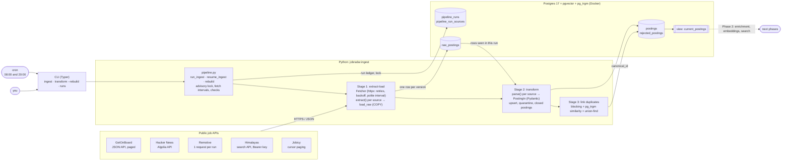

# Architecture

What runs where, as built in Phase 1. Later phases add LLM enrichment, retrieval and the agent on top of the same Postgres database (see the [project overview](../../specs/00-overview.md)).

## Reading it

- **One process per run.** The CLI calls plain functions in `pipeline.py`; cron is just another caller. An orchestrator (Dagster, later) can call the same functions.
- **The lock** is a Postgres advisory lock held for the whole run, so a second run started meanwhile exits at once.
- **Each stage of each source is its own transaction**, so a failure or a crash undoes only the stage it hit (see [state machines](state-machines.md)).
- **Everything lives in one database** ([ADR-0002](../adr/0002-postgres-with-pgvector.md)): the ledger, the raw and clean layers, and later the embeddings.

Code: [cli.py](../../src/jobradar/cli.py), [pipeline.py](../../src/jobradar/ingest/pipeline.py), [http.py](../../src/jobradar/ingest/http.py), [sources/](../../src/jobradar/ingest/sources/), [transform.py](../../src/jobradar/ingest/transform.py), [link.py](../../src/jobradar/ingest/link.py).
