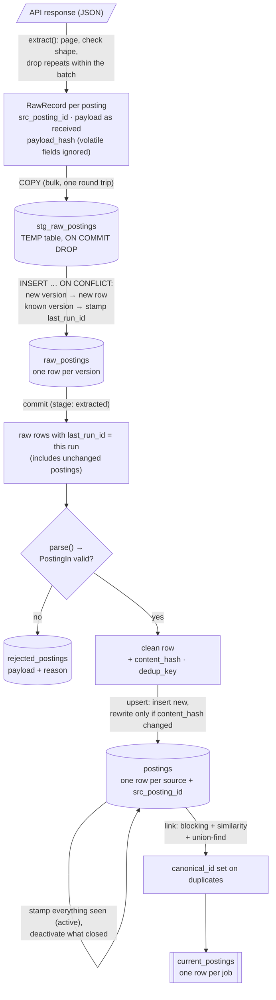
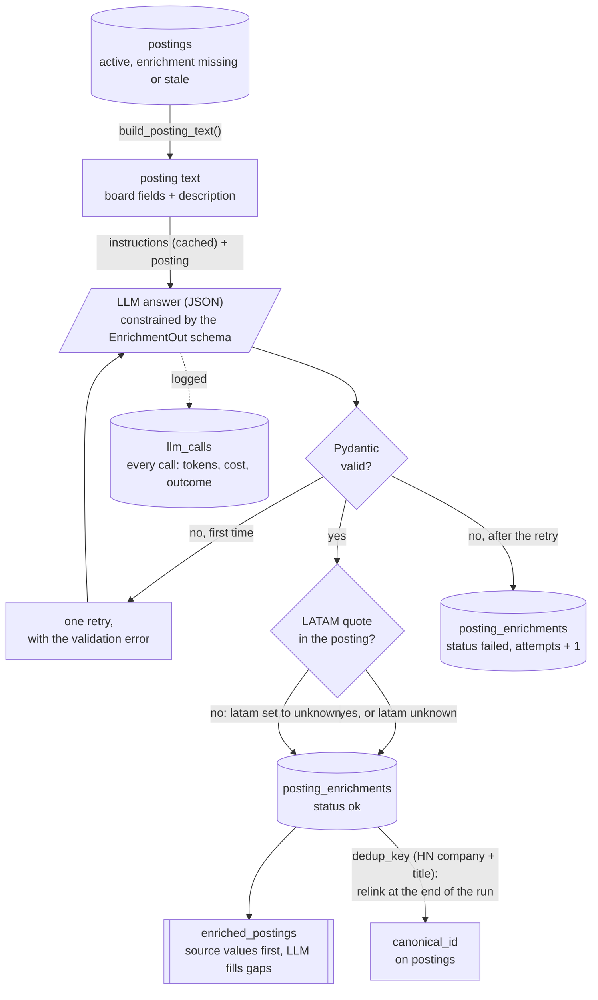
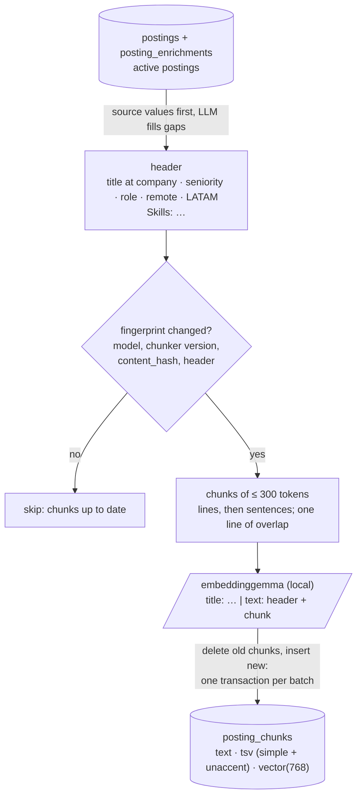

# Data flow

How postings travel from an API response to what search reads: ingestion, LLM enrichment, then indexing. Boxes are data; arrows are the code that moves it.

## Ingestion (one source in a run)

## Two hashes, two questions

| Hash | Computed over | Answers |
|---|---|---|
| `payload_hash` | the raw payload, minus volatile fields (e.g. GetOnBoard's `applications_count`) | "Is this a new *version* of the posting?" → a new row in `raw_postings` |
| `content_hash` | the parsed `PostingIn` fields | "Did anything we *keep* change?" → rewrite the row in `postings` |

A logo URL change makes a new raw version but no update in `postings`; an edited description changes both.

## Checks along the way

- **0 records** from a source fails it *before* the transform, so "not seen → inactive" can't close every posting.
- **More than 20% rejected** fails the source; the rejections are kept, `postings` is not touched, and `--resume` re-transforms after a fix.
- **Rejected new version of a known posting**: it was still listed, so its previous clean row stays active.

Code: [sources/base.py](../../src/jobradar/ingest/sources/base.py) (`RawRecord`, `payload_hash`), [pipeline.py](../../src/jobradar/ingest/pipeline.py) (`load_raw`), [posting.py](../../src/jobradar/ingest/posting.py) (`PostingIn`), [transform.py](../../src/jobradar/ingest/transform.py), [link.py](../../src/jobradar/ingest/link.py).

## Enrichment

What `jobradar enrich` does with each active posting whose enrichment is missing or stale.

- **Stale** means: no enrichment yet, the posting's `content_hash` changed, or `PROMPT_VERSION` changed. A failed enrichment is retried on later runs until it has 3 failed attempts on the same content and prompt.
- **API errors** (network, provider down) write no enrichment: the posting stays stale and the next run tries again. They're still logged in `llm_calls`.
- Each posting's calls and result are committed in one transaction.

Code: [enrich/pipeline.py](../../src/jobradar/enrich/pipeline.py), [enrich/schema.py](../../src/jobradar/enrich/schema.py), [enrich/grounding.py](../../src/jobradar/enrich/grounding.py), [llm/](../../src/jobradar/llm/).

## Indexing

What `jobradar index` does with each active posting whose chunks are missing or out of date.

- Every active posting is indexed, not only each group's representative; search de-duplicates through `current_postings` at query time.
- Inactive postings keep their chunks (search filters them out), so a posting that reopens needs no re-embedding.

Code: [retrieval/indexer.py](../../src/jobradar/retrieval/indexer.py), [retrieval/chunk.py](../../src/jobradar/retrieval/chunk.py), [retrieval/embed.py](../../src/jobradar/retrieval/embed.py).
