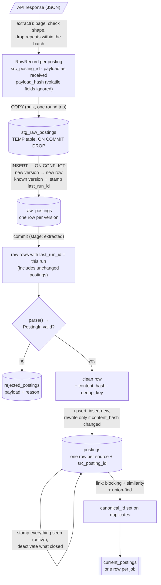

# Data flow

How one source's postings travel through a run, from the API response to the view that later phases read. Boxes are data; arrows are the code that moves it.

## Two hashes, two questions

| Hash | Computed over | Answers |
|---|---|---|
| `payload_hash` | the raw payload, minus volatile fields (e.g. GetOnBoard's `applications_count`) | "Is this a new *version* of the posting?" → a new row in `raw_postings` |
| `content_hash` | the parsed `PostingIn` fields | "Did anything we *keep* change?" → rewrite the row in `postings` |

A logo URL change makes a new raw version but no update in `postings`; an edited description changes both.

## Checks along the way

- **0 records** from a source fails it *before* the transform, so "not seen → inactive" can't close every posting.
- **More than 20% rejected** fails the source; the rejections are kept, `postings` is not touched, and `--resume` re-transforms after a fix.
- **Rejected new version of a known posting**: it was still listed, so its previous clean row stays active.

Code: [sources/base.py](../../src/jobradar/ingest/sources/base.py) (`RawRecord`, `payload_hash`), [pipeline.py](../../src/jobradar/ingest/pipeline.py) (`load_raw`), [posting.py](../../src/jobradar/ingest/posting.py) (`PostingIn`), [transform.py](../../src/jobradar/ingest/transform.py), [link.py](../../src/jobradar/ingest/link.py).
