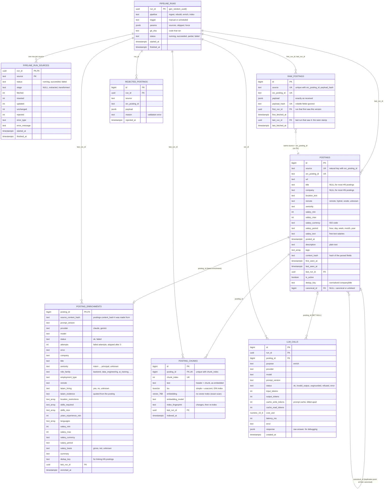

# Entity-relationship diagram

The schema after migration `0007`: ingestion (Phase 1) plus enrichment and retrieval (Phase 2). Types are Postgres types, with brackets and parentheses spelled out because Mermaid doesn't accept them in type names: `text_array` is `text[]`, `vector_768` is `vector(768)`, `numeric_10_6` is `numeric(10,6)`.

## Notes

- **Two identities.** Within a source, `(source, src_posting_id)` is the natural key. Across sources, `canonical_id` groups postings of the same job (entity resolution); rows are never merged or deleted.
- **`raw_postings` ↔ `postings` has no foreign key on purpose.** Raw holds every version and lands first; `postings` holds the current parse. They join on `(source, src_posting_id)`.
- **Run totals are not stored** on `pipeline_runs`: they're `SUM`s over `pipeline_run_sources` (one copy of each number).
- **Allowed values** (sources, statuses, stages, remote, salary period) are `TEXT` columns with `CHECK` constraints, not Postgres `ENUM` types.
- **View `current_postings`** (not drawn): `postings` columns plus `group_id`, one row per job group, keeping the canonical if active, else the oldest active copy.
- **Source facts and LLM fields are kept apart.** `postings` holds what the sources said; `posting_enrichments` holds what the LLM extracted. The view **`enriched_postings`** (not drawn) joins `current_postings` to successful enrichments and adds `resolved_*` columns (the source's value when it has one, otherwise the LLM's) and `remote_modes` (both values when the board's modality and the posting's text disagree).
- **Run counts for enrich and index aren't stored:** they are `SUM`s over `llm_calls.run_id` and counts by `last_run_id`.

Code: [models/](../../src/jobradar/models/), [migrations/versions/](../../migrations/versions/).
