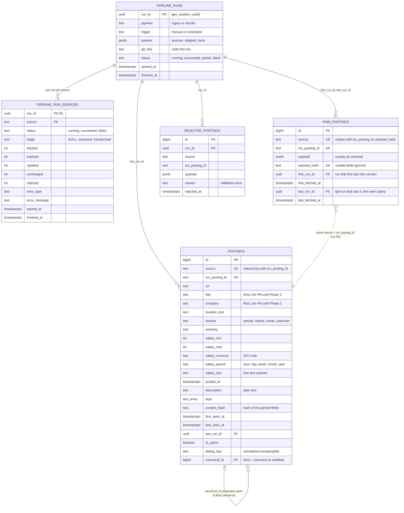

# Entity-relationship diagram

The ingestion schema after migration `0004`. Types are Postgres types (`text_array` is `text[]`, written that way because Mermaid doesn't accept brackets in type names).

## Notes

- **Two identities.** Within a source, `(source, src_posting_id)` is the natural key. Across sources, `canonical_id` groups postings of the same job (entity resolution); rows are never merged or deleted.
- **`raw_postings` ↔ `postings` has no foreign key on purpose.** Raw holds every version and lands first; `postings` holds the current parse. They join on `(source, src_posting_id)`.
- **Run totals are not stored** on `pipeline_runs`: they're `SUM`s over `pipeline_run_sources` (one copy of each number).
- **Allowed values** (sources, statuses, stages, remote, salary period) are `TEXT` columns with `CHECK` constraints, not Postgres `ENUM` types.
- **View `current_postings`** (not drawn): `postings` columns plus `group_id`, one row per job group, keeping the canonical if active, else the oldest active copy.

Code: [models/](../../src/jobradar/models/), [migrations/versions/](../../migrations/versions/).
