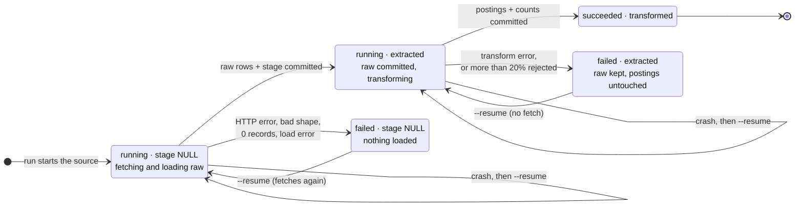
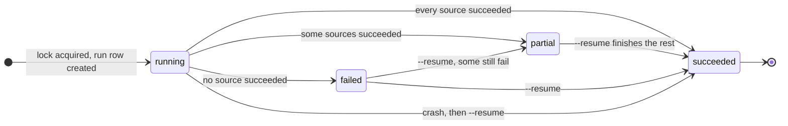
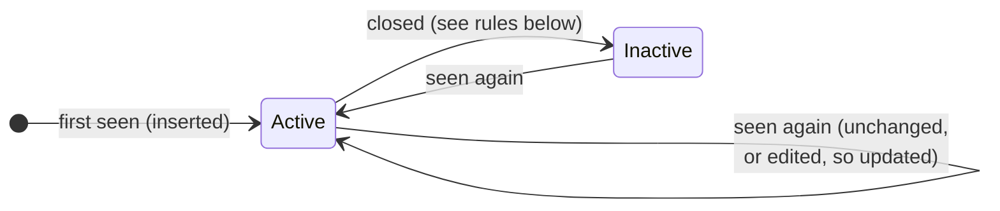
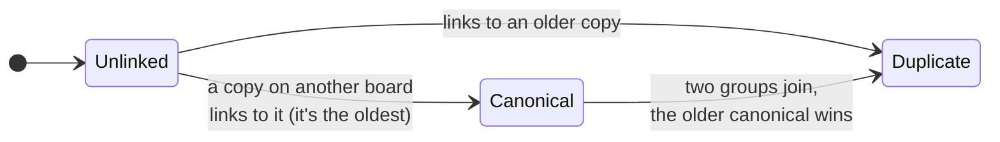
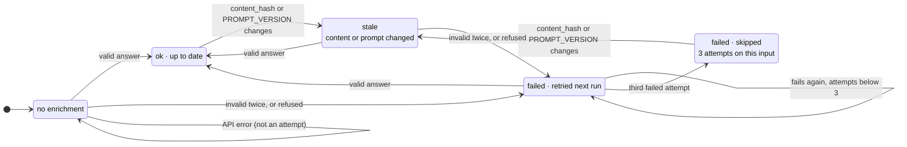

# State machines

Four things have a lifecycle worth drawing: a source within an ingest run, a run, a posting, and a posting's enrichment.

## A source within a run

Stored in `pipeline_run_sources` as two columns: `status` (running, succeeded, failed) and `stage` (NULL, extracted, transformed). Each state below is one combination. Every arrow is a committed transaction, so a crash (even `kill -9`) leaves the row in the last state it reached, never in between.

Not drawn: a source **inside its minimum fetch interval** (Remotive 6 h, Himalayas 20 h, Jobicy 1 h) is skipped before the run creates its row, and the run records it in `params.skipped`.

## A run

`pipeline_runs.status`, computed from its sources when the run ends.

Only the **latest** ingest run can be resumed: a newer run has re-stamped the raw rows, so an older one would see an incomplete batch.

## A posting

Two independent dimensions: whether the job is still open (`is_active`), and how it relates to copies on other boards (`canonical_id`).

**Open or closed** (`is_active`):

**Cross-source identity** (`canonical_id`):

**Closing rules** (the `Active → Inactive` arrow):

- GetOnBoard, Remotive, Himalayas, Jobicy: not returned by a **successful** extract of the source. These boards drop closed jobs from their APIs.
- Hacker News: the comment is more than 45 days old, or it was deleted from a thread fetched in that run.

**Identity rules:** links are never removed automatically, and a canonical stays canonical after it closes. Which copy represents the job is decided at read time by the `current_postings` view (the canonical if active, else the oldest active copy).

Code: [pipeline.py](../../src/jobradar/ingest/pipeline.py), [transform.py](../../src/jobradar/ingest/transform.py) (`_deactivate`), [link.py](../../src/jobradar/ingest/link.py).

## A posting's enrichment

The row in `posting_enrichments` (none at first), as `jobradar enrich` sees it. Only active postings are considered.

"ok" includes answers whose LATAM quote wasn't found in the posting: they are kept, with `latam_hiring` set to unknown (`llm_calls.status` = ungrounded).

Code: [enrich/pipeline.py](../../src/jobradar/enrich/pipeline.py) (`_is_stale`, `_upsert_failed`).
